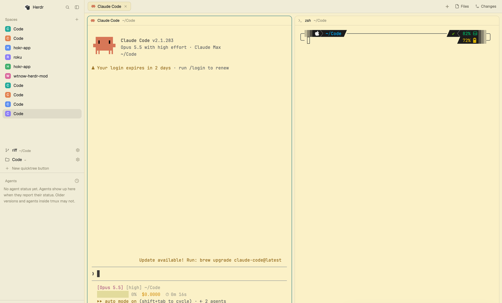

# Quicktree, a Herdr mod

One-click workspaces for the [Herdr](https://herdr.dev) app. Each button under your
Spaces list opens a fresh git worktree of a repo as a new space: your agent (Claude
Code, Codex, Pi…, any `--model`) on the left, a terminal on the right. Outside git
it opens the folder itself. `cmd-shift-n` does the same from the keyboard.

Install: `git clone https://github.com/calebcauthon/herdr-quicktree && herdr-quicktree/install.sh`.
It copies `mods/quicktree/`, adds the buttons under Spaces in a `main-quicktree` layout
and merges `keys.json`. [RECIPE.md](RECIPE.md) is the brief to build it from scratch.

## License

[MIT](LICENSE).
