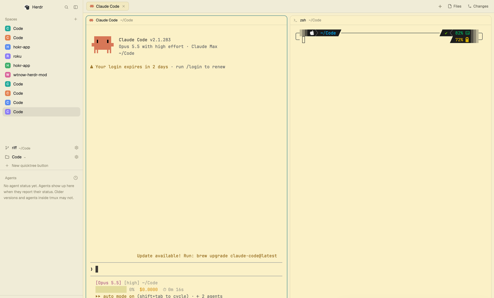

# Quicktree

Buttons at the bottom of the Spaces sidebar, one per folder the person sets up.
Pressing one opens a new space on a fresh git worktree of that folder's repo (or on
the folder itself outside git), with the chosen agent and model in the left pane and
a plain terminal split on the right. `cmd-shift-n` does the same from anywhere.

## What you see

- **The buttons**, in a 40px+ block directly under the `spaces` block of the sidebar
  (`chrome` background, 8px side padding, rows aligned to the bottom). One 30px row
  per button: a 14px icon (`mods/workspace-chrome/branch.svg` when it makes
  worktrees, `folder.svg` when it doesn't), the folder's name in `foreground` 13px,
  then its parent folder (with `~` for home) in `dim` 11px, truncated, and a 24px ⚙
  (`settings.svg`, `dim`) on the right. With exactly one button, its row also shows
  the hotkey (`⇧⌘N`) in `dim` 11px. Below the rows is a 26px row, `+ New quicktree button`,
  in `dim` 12px. Rows get `hover` backgrounds, rounded 8px.
- **Narrow sidebar** (the `sidebar` node under 160px): icons only, no ⚙ or text.
- **The button dialog** (480×520, `popover`): title "New quicktree button" / "Edit
  quicktree button", a one-line explanation, then *Starting folder* (an input plus
  a *Choose…* button that opens the system folder picker), a *Make a worktree*
  checkbox with a note on the right ("A new branch and worktree of <repo> each
  time.", "Opens the folder itself, no worktree.", or "Not a git repo: opens the
  folder itself, no worktree." with the box dimmed and unchecked), *Agent* (a 124px
  scrolling list of installed agents with their icon, name and command; the chosen
  one `selected`), *Model (passed as --model)* and *Branch prefix* (default `wt/`)
  side by side. The footer shows: *Delete* (red, only when editing), `↵ save · esc cancel`,
  *Cancel*, and *Save* (`solid`).
- **The picker** (420 wide, a popup at the top): "Quicktree" in `dim` 11px, then
  a row per button: icon, folder name, agent name, its number 1–9.
- **The run popup** (460×150 at the top): "New worktree of <repo>" or "New space
  in <folder>", the agent's name on the right, the branch, and the current step
  (`git worktree add ~/.herdr/worktrees/…`). On failure, the git error in
  `blocked`, and "esc close".

## How it behaves

- **Click a button**: if it makes worktrees and its folder is in git, it creates the branch
  `<prefix><MMDD>-<HHMM>` (adding `-2`, `-3`… if taken) from the folder's `HEAD`
  with `git worktree add -b <branch> ~/.herdr/worktrees/<repo>/<branch as slug>`.
  Then `space.new {folder, machine: "", tab: <agent name>, argv: [...agent.run,
  "--model", model]}` (no `--model` when it's empty), `terminal.open {folder,
  place: "right"}`, then, 150ms later, `pane.focus` on the tab's other pane (the
  agent) so the agent has the keyboard. The space is left unnamed, so Herdr names
  it after the checkout and nests it under its repo.
- **Otherwise** (no git, or *Make a worktree* off): the same, on the folder itself.
- **⚙ or right-click a row**: the dialog for that button. **+ New quicktree button**: an
  empty dialog. Saving with a folder that doesn't exist, or with no agent, shows a red
  error. The worktree setting is saved off when the folder isn't in git.
- **cmd-shift-n** (`mod.open:quicktree`): no buttons → the new-button dialog; one →
  runs it; several → the picker (`1`–`9` run one, `↵` the first, `esc` closes).
- The block resizes itself to fit (`layout.resize {id: "quicktree", px: 10 + 30·n + 28}`).
- Agent statuses aren't shown: the spaces and agents lists already do that.

## Built from

- One mod, `mods/quicktree/`, with four roles chosen in `init` from `props()`: no
  `overlay` → the buttons; `mode: "settings"` (with `id`, or none for new) → the
  dialog; `mode: "pick"` → the picker; anything else (with `id`, or from `mod.open`)
  → the run popup. Overlays are opened with `openOverlay({mod: "quicktree", ...})`.
  `mod.json`: `place: "none"`, overlay `popup` at top, 460×150.
- Layout: a personal clone of `main` (`layout.clone {name: "main", as: "main-quicktree"}`)
  with `{ "id": "quicktree", "type": "block", "size": { "px": 40 }, "content": { "mod": "quicktree" } }`
  inserted after `spaces` in the `sidebar-lists` column.
- `keys.json`: `"global": { "cmd-shift-n": "mod.open:quicktree" }`.
- State: `shared("quicktree.buttons")`: `[{ id, folder, agent: {key, name, run},
  model, prefix, worktree }]`.
- herdr: `exec` (git, `test -d`), `knownAgents`, `pickFolder`, `run`, `focused`,
  `panes`, `layout`, `keys`, `theme`, `shared`/`setShared`, `openOverlay`/`closeOverlay`.
  Icons are the shipped `mods/workspace-chrome/*.svg`.
- Programs it runs: `git`, and the chosen agent.

## Watch out

- `space.new` returns nothing to a mod. It does select the new space, so
  `terminal.open {place: "right"}` right after splits the right pane. `pane.go
  left` right after does nothing (the split isn't laid out yet), so wait and use
  `pane.focus` with the pane id from `panes()`.
- Herdr's hot reload doesn't follow a symlinked mod folder: copy it into `mods/`.
- Shipped layouts are read-only, so the block needs a personal layout.
- `knownAgents()` is slow the first time; show "Checking installed agents…".
- Worktrees are made on this machine only (`machine: ""`).

## Done when

- `herdr-app check ~/.config/herdr-app/mods/quicktree` passes.
- With no buttons, the block shows only `+ New quicktree button`; clicking it opens the dialog.
- Saving a git repo with Claude Code and model `opus` adds a branch-icon row; clicking it
  makes `~/.herdr/worktrees/<repo>/wt-MMDD-HHMM` on branch `wt/MMDD-HHMM`, opens a
  space named after it under the repo, runs `claude --model opus` on the left with
  the keyboard, and a shell in the same folder on the right.
- A non-git folder saves with a folder icon and opens a space on the folder, no worktree.
- With two buttons, `cmd-shift-n` opens the picker and `2` runs the second.
